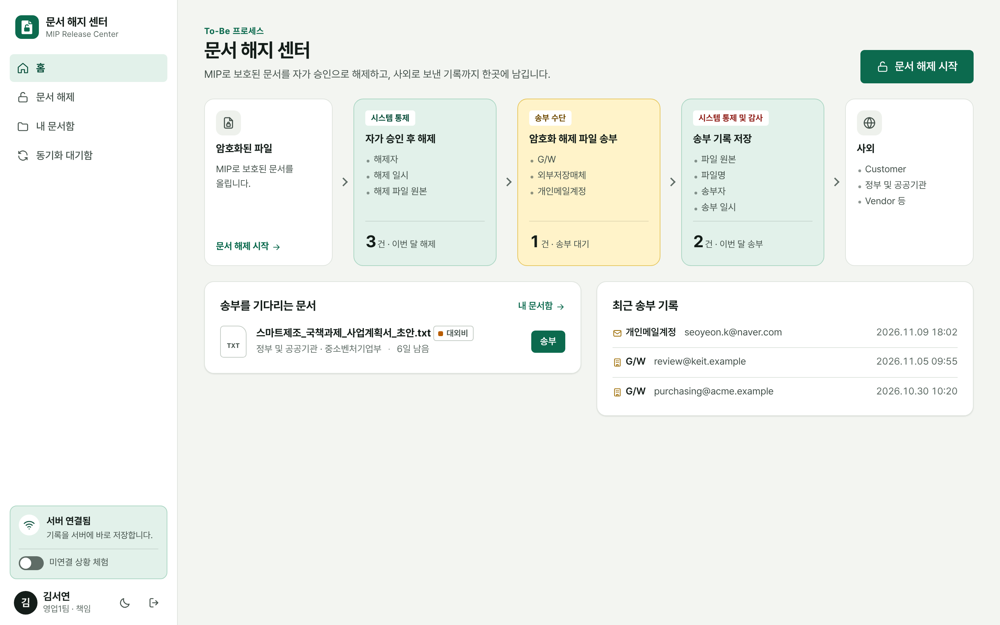
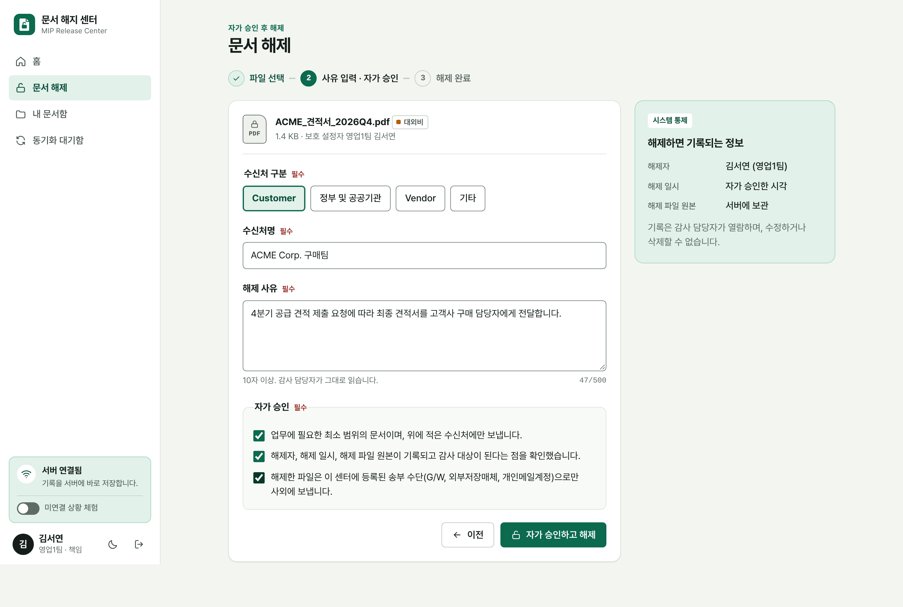
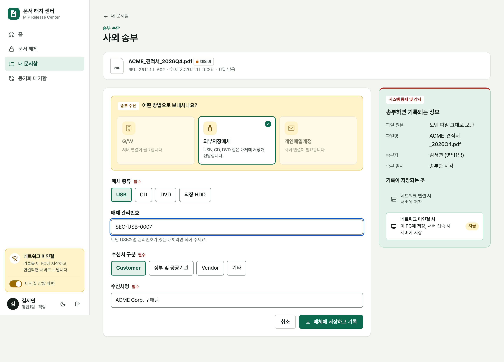
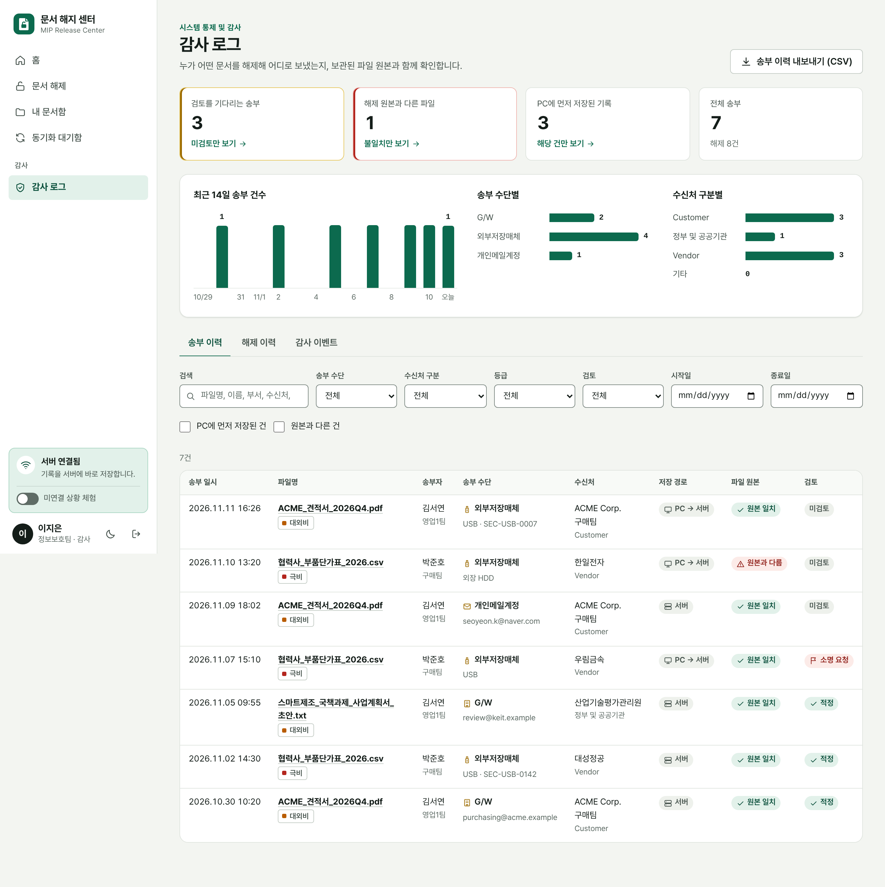

# 문서 해지 센터 (MIP Release Center)

Microsoft MIP(Purview Information Protection)로 보호된 문서를 **자가 승인 후 해제**하고,
해제한 파일을 사외로 보낸 기록을 **파일 원본과 함께** 남기는 웹 앱입니다.
아래 To-Be 프로세스를 그대로 화면과 데이터로 옮겼습니다.

```
암호화된 파일 → 자가 승인 후 해제 → 암호화 해제 파일 → 송부 수단 → 시스템 통제 및 감사 → 사외
                [시스템 통제]                          G/W            [저장 정보]        Customer
                 · 해제자                              외부저장매체     · 파일 원본        정부 및 공공기관
                 · 해제 일시                           개인메일계정     · 파일명           Vendor 등
                 · 해제 파일 원본                                      · 송부자
                                                                      · 송부 일시
                                     네트워크 연결 시   : 서버에 저장
                                     네트워크 미연결 시 : PC에 저장, 서버 접속 시 서버에 저장
```

| 홈 | 문서 해제 (자가 승인) |
|---|---|
|  |  |

| 사외 송부 (네트워크 미연결) | 감사 로그 |
|---|---|
|  |  |

## 실행

Node.js 22.5 이상만 있으면 됩니다. 설치할 패키지가 없습니다(`npm install` 불필요).

```bash
npm run demo
```

브라우저에서 <http://127.0.0.1:4300> 을 엽니다. `npm run demo`는 예시 이력을 넣고 시작하고,
`npm start`는 빈 상태로 시작합니다. 데이터는 `data/` 폴더에 쌓입니다.

```bash
npm test
```

### 체험 순서

1. **김서연**(일반 사용자)으로 들어가 `문서 해제`에서 샘플 문서를 고릅니다.
   `임원_인사평가_결과.csv`는 권한이 없어 해제가 거부되는 경우를 보여 줍니다.
2. 수신처와 해제 사유를 적고 세 항목에 동의하면 암호화가 해제됩니다.
3. `지금 송부하기`에서 G/W, 외부저장매체, 개인메일계정 중 하나로 보냅니다.
4. 왼쪽 아래 **미연결 상황 체험** 스위치를 켜고 외부저장매체로 한 번 더 보냅니다.
   기록이 PC에 남고(`동기화 대기함`), 스위치를 끄면 서버로 올라갑니다.
5. **이지은**(감사 담당)으로 들어가 `감사 로그`에서 방금 건을 열어 파일 원본을 내려받고 검토 결과를 남깁니다.

## 화면

| 화면 | 하는 일 |
|---|---|
| 홈 | 프로세스 흐름 위에 내 현황(이번 달 해제, 송부 대기, 이번 달 송부)을 얹어 보여 줍니다. |
| 문서 해제 | 파일 선택 → 사유 입력 · 자가 승인 → 해제 완료. 등급, 보호 설정자, 해제 권한을 먼저 확인합니다. |
| 내 문서함 | 해제한 문서와 송부 이력. 해제 후 7일 동안 송부할 수 있습니다. 감사 담당자의 소명 요청도 여기에 보입니다. |
| 사외 송부 | 송부 수단을 고르고 보냅니다. 지금 기록이 서버와 PC 중 어디에 저장되는지 함께 보여 줍니다. |
| 동기화 대기함 | 서버 저장을 기다리는 송부 기록과, 이 PC에 보관 중인 해제 파일. |
| 감사 로그 (감사 담당) | 송부 이력 · 해제 이력 · 감사 이벤트. 걸러 보기, 파일 원본 열람, 검토, CSV 내보내기, 체인 검증. |

밝은 화면과 어두운 화면, 좁은 화면(320px)을 지원합니다.

## 무엇이 저장되나

| 시점 | 저장 정보 | 위치 |
|---|---|---|
| 해제 | 해제자, 해제 일시, 해제 파일 원본, 보호된 원본, 등급, 사유, 수신처, SHA-256 | `releases` 테이블, `data/vault/releases/` |
| 송부 | 파일 원본, 파일명, 송부자, 송부 일시, 송부 수단과 상세, 수신처, SHA-256, 서버 저장 일시 | `transfers` 테이블, `data/vault/transfers/` |
| 모든 행위 | 로그인, 해제, 해제 거부, 송부, 동기화, 검토, 감사자의 원본 열람, 내보내기 | `audit_events` 테이블 (해시 체인) |

- **원본 일치 여부**: 송부된 파일의 해시를 해제 원본과 비교합니다. 다르면 감사 로그에 `원본과 다름`으로 표시됩니다.
- **감사 체인**: 감사 이벤트는 앞 이벤트의 해시를 품고 이어집니다. 중간 기록을 고치거나 지우면 `체인 검증`에서 몇 번째 이벤트가 깨졌는지 나옵니다.
- **검토 분리**: 감사 담당자도 본인이 송부한 건은 직접 검토할 수 없습니다.

## 네트워크 미연결 시 동작

- 문서를 해제하면 해제 파일 사본이 이 PC(브라우저 IndexedDB)에도 보관됩니다.
- 서버에 닿지 않을 때 외부저장매체로 보내면, 송부 기록이 PC에 저장되고 `동기화 대기함`에 쌓입니다.
- 서버에 다시 닿으면 파일 원본과 함께 자동으로 서버에 저장됩니다. 송부 일시는 PC가 적어 둔 시각이고,
  서버 저장 일시가 따로 남습니다. 같은 기록이 두 번 올라가도 한 건만 저장됩니다.
- PC 시각이 해제 이전이거나 미래면 서버 시각으로 바로잡고 그 사실을 기록에 남깁니다.
- G/W와 개인메일계정은 서버가 메일을 보내므로 서버 연결이 필요합니다. 암호화 해제도 마찬가지입니다.
- 앱 화면은 서비스 워커가 받아 두므로, 미연결 상태에서 새로 고쳐도 열립니다.

## 구조

```
server/
  app.js              HTTP 서버, 라우트, 세션, 권한
  services.js         해제 · 송부 · 감사 업무 로직
  audit.js            해시 체인 감사 이벤트
  db.js               SQLite 스키마 (Node 내장 node:sqlite)
  mip/mock-adapter.js     체험용 모의 MIP 어댑터 (AES-256-GCM 컨테이너)
  mip/sidecar-adapter.js  실제 MIP SDK 서비스에 위임하는 어댑터
  connectors/mail.js      메일 커넥터 (지금은 .eml 파일로 outbox 에 기록)
  samples.js, seed.js     샘플 문서, 데모 이력
web/
  js/lib/             API, 네트워크 상태, PC 저장소(IndexedDB), 동기화, 공용 UI
  js/views/           화면별 모듈
  styles/tokens.css   색 · 글꼴 토큰 (밝은 화면 / 어두운 화면)
  sw.js               앱 화면 오프라인 캐시
test/api.test.js      API 테스트 14건
```

외부 의존성이 없습니다. 서버는 Node 내장 모듈만 쓰고, 화면은 빌드 없이 ES 모듈로 동작하며 외부 CDN을 부르지 않습니다(폐쇄망에서 그대로 동작).

### 환경 변수

| 이름 | 기본값 | 설명 |
|---|---|---|
| `PORT`, `HOST` | `4300`, `127.0.0.1` | 서버 주소 |
| `DATA_DIR` | `./data` | DB와 보관 파일 위치 |
| `MIP_ADAPTER` | `mock` | `sidecar`로 바꾸면 실제 MIP SDK 서비스를 씁니다 |
| `MIP_SIDECAR_URL` | - | 사이드카 서비스 주소 |
| `CORP_DOMAINS` | `hanbit.example` | 회사 메일 도메인(쉼표 구분). 개인메일 송부에서 걸러 냅니다 |
| `RELEASE_TTL_DAYS` | `7` | 해제 후 송부 가능 기간 |
| `MAX_FILE_MB` | `50` | 파일 크기 한도 |
| `SESSION_SECRET` | 자동 생성 | 세션 쿠키 서명 키 |
| `COOKIE_SECURE` | - | `1`이면 쿠키에 Secure를 붙입니다(HTTPS 운영 시) |
| `TZ` | 시스템 값 | 일별 집계와 번호(`REL-YYMMDD-NNN`)의 날짜 기준. 예: `Asia/Seoul` |

## 운영에 올리기 전에 바꿔야 할 것

이 저장소는 흐름 전체가 실제로 동작하는 **체험 가능한 기준 구현**입니다. 아래 네 가지는 모의 구현이므로 운영 전에 교체해야 합니다.

1. **MIP 해제 (가장 중요)**
   지금은 모의 어댑터가 자체 컨테이너(`.pfile`)를 만들고 풉니다. 실제 MIP 보호 파일은 해제하지 못하며,
   그런 파일을 올리면 "MIP SDK 어댑터를 연결해야 한다"고 안내합니다.
   실제 연결은 MIP File SDK를 감싼 사내 서비스를 두고 `MIP_ADAPTER=sidecar`로 붙입니다. 계약은 다음과 같습니다.

   | 요청 | 본문 | 응답 |
   |---|---|---|
   | `POST {url}/inspect` | 파일 바이트 | JSON: `protected`, `supported`, `labelId`, `owner`, `protectedAt`, `originalName`, `mime`, `canUnprotect`, `denyReason` |
   | `POST {url}/unprotect` | 파일 바이트 | 해제된 파일 바이트. 헤더 `X-File-Name`(URL 인코딩), `Content-Type` |

   두 요청 모두 `X-File-Name`, `X-User-Email` 헤더가 실립니다. 오류는 `{ "message": "..." }` JSON으로 돌려주면 화면에 그대로 안내됩니다.
   사이드카 자체는 이 저장소에 없고, 어댑터는 가짜 사이드카로만 시험했습니다. 실제 테넌트에서는 해제 주체의 권한
   (사용자 위임인지, 슈퍼 사용자 서비스 계정인지)과 레이블 ID → `general` / `confidential` / `highly` 매핑을 정해야 합니다.

2. **로그인**: 지금은 계정을 골라 들어가는 체험용 화면입니다. `server/app.js`의 세션 부분을 Entra ID SSO(OIDC)로 바꾸고,
   `/api/users`와 `POST /api/session`을 닫아야 합니다. 감사 담당 여부는 그룹이나 앱 역할로 받으면 됩니다.

3. **메일 발송**: G/W와 개인메일 송부는 실제로 보내지 않고 `data/outbox/*.eml`로 남깁니다.
   `server/connectors/mail.js`의 `send` 하나를 그룹웨어 메일 API나 SMTP 릴레이 호출로 바꾸면 됩니다.

4. **우회 경로 차단**: 이 앱은 "센터를 거친 송부"를 기록합니다. 센터를 거치지 않고 해제 파일을 메신저나 웹으로
   내보내는 것을 막는 일은 엔드포인트 DLP나 매체 제어 솔루션의 몫입니다. 외부저장매체 송부도 브라우저의 저장 창으로
   파일을 내어 주고 사용자가 고른 매체 종류를 기록하는 방식이라, 실제로 어느 장치에 썼는지는 확인하지 못합니다.

그 밖에 알아 둘 점:

- 파일은 요청 한 번에 메모리로 받습니다(기본 50MB 한도). 더 큰 파일이 필요하면 스트리밍 저장으로 바꿔야 합니다.
- 해제 파일 사본은 브라우저 프로필 단위로 보관됩니다. 여러 사람이 한 PC의 같은 브라우저 프로필을 쓰는 환경이라면
  `동기화 대기함`에서 사본을 지우거나, 사본 보관을 끄는 정책이 필요합니다.
- 요청 횟수 제한이 없습니다. 사내망의 리버스 프록시(TLS 종단, 접근 제어) 뒤에 두는 것을 전제로 했습니다.
- 감사 체인은 DB 안에서의 변조를 드러내지만, DB 전체를 통째로 바꾸는 것까지 막지는 못합니다.
  마지막 해시를 주기적으로 외부(예: SIEM)에 내보내 두면 보완됩니다.

## 확인한 것

- API 테스트 14건 통과: 해제 · 권한 거부 · 헤더 조작 탐지, 세 가지 송부 수단, 오프라인 기록의 시각 처리와 중복 방지,
  기간 만료, 권한 분리, CSV, 감사 체인 변조 탐지, 사이드카 어댑터.
- 실제 브라우저(Chromium)로 전체 흐름을 돌려 콘솔 오류가 없음을 확인했습니다. 네트워크를 실제로 끊은 상태에서
  새로 고침, 외부저장매체 송부, 재접속 후 자동 동기화, 감사 로그 반영까지 확인했습니다.
- 접근성: 밝은 화면과 어두운 화면의 글자 · 테두리 · 아이콘 색 대비 35개 조합이 WCAG 2.1 AA 기준(글자 4.5:1, 조작 요소 3:1)을
  넘습니다. 키보드만으로 해제와 송부를 끝낼 수 있고, 화면 이동 · 오류 · 완료 때 포커스가 맞는 곳으로 옮겨집니다.
  화면 낭독기(NVDA, VoiceOver)로 직접 들어 보는 확인은 하지 않았습니다.
- 확인하지 못한 것: 실제 MIP 테넌트와 SDK 연동, 실제 메일 발송, Chromium 이외의 브라우저.
